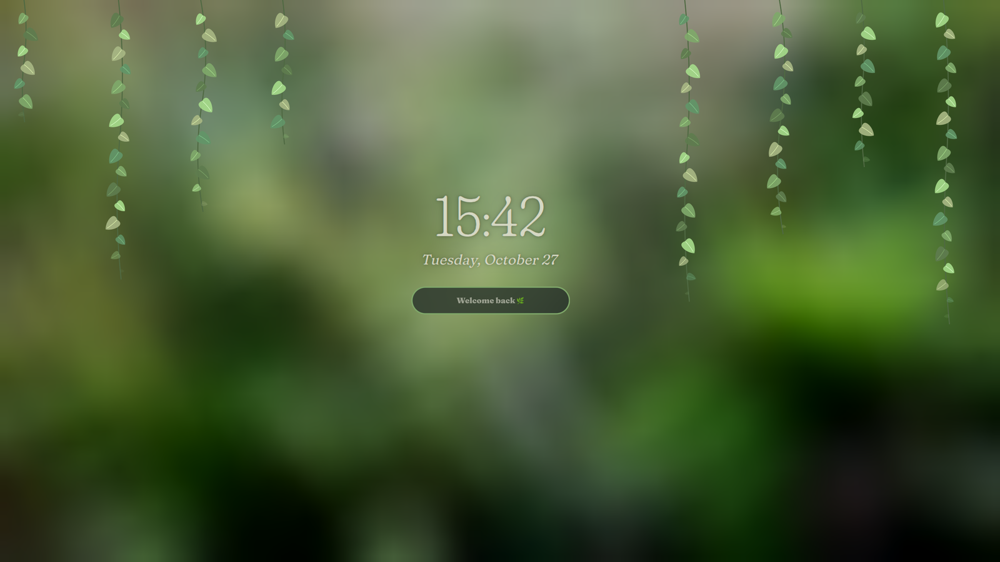

# Omarchy Greenhouse Extras

Optional extras for the [Omarchy Greenhouse](https://github.com/BBIEPavkov/omarchy-greenhouse-theme) theme: a houseplant lock screen, a leaf bar, leaf popups, a green cursor, and a monstera screensaver. They take their colors from the theme and only show while it's active, so switching to another theme brings back Omarchy's built-ins.



## Install

Requires Omarchy 4 (Quattro).

```bash
git clone https://github.com/BBIEPavkov/omarchy-greenhouse-extras ~/.local/share/omarchy-greenhouse-extras
~/.local/share/omarchy-greenhouse-extras/install.sh
```

The script asks before each piece. Run it again any time to add pieces you skipped.

| Extra | What you get |
|-------|--------------|
| Lock screen | Pothos vines grow down from the top and unfurl their leaves, a soft serif clock and date, leaf password dots, thirsty messages and a water drop on each wrong password, a leaf burst on unlock. The layout drifts slowly to avoid burn-in. |
| Bar and popups | A Fraunces serif clock, a leaf on the current workspace, volume and brightness levels shown as growing leaves, and a leaf on every notification |
| Cursor | Leaf green cursor (a recolor of [Catppuccin Cursors](https://github.com/catppuccin/cursors), GPL-2.0) |
| Terminal prompt | A green leaf before the folder name, 🥀 after a failed command ([Starship](https://starship.rs)) |
| Screensaver | A monstera leaf in place of the Omarchy logo |

## Fastfetch (Terminal Logo)

A monstera logo for fastfetch, with leaf-green labels. Back up your current config, then copy this one:

```bash
cp ~/.config/fastfetch/config.jsonc ~/.config/fastfetch/config.jsonc.bak
cp ~/.local/share/omarchy-greenhouse-extras/fastfetch/config.jsonc ~/.config/fastfetch/config.jsonc
```

## Uninstall

Removes everything and brings back Omarchy's built-ins:

```bash
~/.local/share/omarchy-greenhouse-extras/uninstall.sh
```

`omarchy refresh hyprland` resets `~/.config/hypr/hyprland.lua`, which drops the cursor. Run `install.sh` again and say yes to the cursor to bring it back.

## Customizing

To customize the lock screen, edit `~/.config/omarchy/plugins/emilypavkov.greenhouse-lock/LockView.qml` (number of vines, placeholder text) or `Service.qml` (wrong-password messages), then run `omarchy restart shell`.

## Credits

The lock screen and bar clock bundle [Fraunces](https://github.com/undercasetype/Fraunces) under the SIL Open Font License (see each plugin's `OFL.txt`). The plugins are based on Omarchy's built-in ones ([MIT](https://github.com/basecamp/omarchy/blob/master/LICENSE)). The screensaver leaf is a recolor of [Monstera leaf](https://game-icons.net) by Delapouite, CC BY 3.0.
